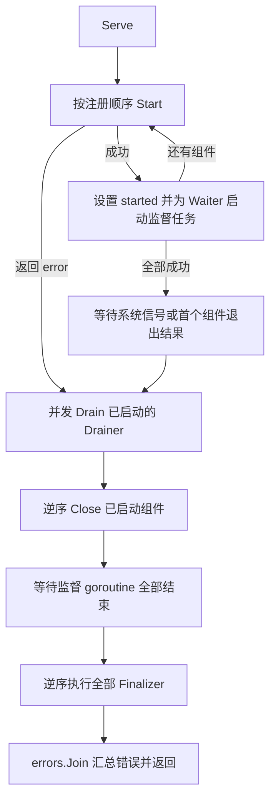

# 容器生命周期与错误处理约定

本文固定当前 Container 的设计和错误处理边界，其他架构文档涉及容器时以本文为准。方案于 2026-10-29 与远端实现核对。

实现位置：

- [核心接口](../internal/framework/component.go)
- [Container 实现](../internal/framework/container.go)
- [生命周期与异常测试](../internal/framework/container_test.go)
- [通用 PanicError](../internal/core/errors.go)

## 一 职责与公开 API

`internal/framework` 提供 Gateway、Logic、Scene 等服务可复用的进程级组件容器。完整 Gateway 作为一个组件注册；它内部的 Router、SessionRegistry、BackendPool 等对象由 Gateway 自行装配和管理。

```go
func NewContainer() *Container
func (c *Container) AddComponent(components ...Component)
func (c *Container) AddFinalizer(finalizers ...Finalizer)
func (c *Container) Serve() error
```

所有注册在 Serve 前完成，每个 Container 只调用一次 Serve。运行期间不增删组件，也不并发修改注册列表。组件 Name 必须在进程内唯一且稳定；当前实现不额外建立名称注册表。AddComponent、AddFinalizer 跳过 nil 参数，调用方仍须保证传入的是有效对象。

没有公开 Stop、Serve 的 once 参数、额外 Init/Destroy 阶段、容器生命周期状态枚举、健康聚合或容器配置结构。准备和校验在构造阶段完成，运行资源由 Start 创建，最终设施清理由 Finalizer 承担。

## 二 接口与设施清理

```go
type Component interface {
    Name() string
    Start() error
    Close() error
}

type Waiter interface {
    Wait() error
}

type Drainer interface {
    Drain(ctx context.Context) error
}

type Finalizer func() error
```

| 定义 | 是否必需 | 约定 |
| --- | --- | --- |
| Component | 必需 | Start 完成启动后返回；Close 停止并释放组件拥有的运行资源 |
| Waiter | 可选 | 等待实际长驻运行任务结束，向容器提供退出结果 |
| Drainer | 可选 | 停止接收新工作、等待在途任务；必须响应 context 取消 |
| Finalizer | 容器注册函数 | 全部组件关闭、监督任务结束后，逆序释放进程级设施 |

Waiter、Drainer 通过类型断言按需使用，不要求每个组件实现空方法。Finalizer 不属于组件接口，不要求业务组件实现 Finalize。当前不定义 HealthReporter 或 requiredForReady，服务可用性由具体服务表达。

### 2.1 组件自身的资源责任

- Start 返回错误时，组件自行清理本次启动产生的半成品；Container 不对失败或未启动组件调用 Drain、Close。
- Close 必须使组件的运行过程结束并使 Wait 返回；返回 error 也不能把后台任务无限期留在运行状态。
- Wait 支持与 Close 并发调用；即使运行任务在 Wait 调用前结束，也必须能够取得退出结果。
- Wait 等待的是运行任务结束。运行异常或 Close 都可能使其返回，不应只等待一个与实际运行任务脱节的停服通知。
- Start、Close 内部阻塞操作的期限由组件负责，Container 不通过遗留后台 goroutine 的方式强行中断它们。
- panic 的行为单独按第五节执行；恢复 panic 并不意味着资源已释放或组件状态已恢复。

### 2.2 Finalizer 的顺序

日志、配置客户端、遥测等设施在 main 中初始化，成功初始化后按依赖顺序注册 Finalizer。先初始化、供其他设施使用的资源先注册，退出时最后释放。日志通常最先注册，使其最后关闭。

已启动组件按契约完成 Drain、Close、Wait 后，全部已注册 Finalizer 都会执行，包括组件启动返回 error 的情况。发生未恢复的同步 panic 或 os.Exit 时，不承诺继续执行 Finalizer。

Serve 返回时，日志设施可能已经关闭。最终错误应写 stderr；main 若需要设置非零进程退出码，应在 Serve 返回后调用 os.Exit。

## 三 数据归属

当前 Container 持有：

| 字段 | 用途 |
| --- | --- |
| `components []*componentEntry` | 按注册顺序保存组件 |
| `componentEntry.started` | Start 成功后置 true，限定后续 Drain、Close 的范围 |
| `finalizers []Finalizer` | 按初始化顺序保存进程级清理函数 |
| `exits chan componentExit` | 保存一个待处理的长驻组件退出结果 |
| `wg sync.WaitGroup` | 等待 Container 创建的监督 goroutine 结束 |

started 记录组件是否成功启动，仅限定资源清理范围。Container 不维护额外生命周期状态机，Serve 只允许执行一次。

系统信号 channel 只在 waitForExit 内使用。Drain 的 context、结果切片和局部 WaitGroup 属于单次排空操作。局部 WaitGroup 等待排空任务，Container.wg 等待运行监督任务，二者不混用。

## 四 执行流程



图中清理路径覆盖返回 error 的情况。Start、Close、Finalizer 的未恢复 panic 会直接向上传播，不保证走完图中的后续步骤。

### 4.1 启动与退出等待

runComponents 正序调用 Start，成功后设置 started 并启动可选 Waiter 的监督 goroutine。任一 Start 返回 error 后停止启动，进入已启动组件的清理流程。

全部启动成功后调用 waitForExit。当前在此方法中注册系统信号监听：os.Interrupt（SIGINT）、SIGTERM、SIGQUIT、SIGTRAP。SIGTRAP 表示调试陷阱，不是内存异常。启动阶段尚未注册该监听，不承诺接收信号后执行优雅回滚；组件自己的启动操作必须有明确期限。

长驻任务永久退出由 Gateway 的 Waiter 暴露给容器，无须向 Gateway 构造函数注入停服回调。可恢复的单连接断开、后端重连由 Gateway 内部处理，不应使完整 Gateway.Wait 提前结束。

### 4.2 一个退出结果即可触发停服

exits 的容量为 1。每个 Waiter 在结束后尝试发送一次结果，发送采用非阻塞 select，缓冲已满则放弃本次重复触发通知。

容量为 1 可以保存进入 waitForExit 之前发生的退出结果；非阻塞发送保证关闭期间无人接收时，监督任务仍可结束。发送只保留一个位置，当前在 Wait 的局部恢复函数返回之后执行。

Container 只消费首个触发停服的结果，不承诺汇总所有 Waiter 在关闭期间返回的错误。监督任务自身记录其非 nil 错误；不能为了收集更多退出结果而阻塞整个关闭流程。

### 4.3 排空和关闭

所有已启动且实现 Drainer 的组件并发执行 Drain，全部返回后再逆序 Close。并发排空不保证不同入口在完全相同的时刻停止接收；有严格业务依赖的入口在完整组件内部组织。

当前所有 Drain 共用 15 秒 context 期限。它是协作式取消：Drain 必须响应 ctx.Done()。Container 等待所有 Drain 返回后才 Close，不宣称能够强制终止不响应取消的 goroutine。

排空结果预分配固定切片，每个 goroutine 只写自己的 results[index]，局部 WaitGroup.Wait 后再读取。nil 元素由 errors.Join 忽略。Wait 完成后再追加 context 错误是安全的；不能在多个排空 goroutine 中并发 append 同一结果切片。

Close 按注册逆序执行，某个 Close 返回 error 不阻止其余组件关闭。之后 Container.wg.Wait 确认全部监督 goroutine 结束，再执行 Finalizer。

## 五 错误处理约定

### 5.1 返回 error、系统信号和 panic

| 来源 | 容器行为 | Serve 结果 |
| --- | --- | --- |
| Start 返回 error | 停止启动后续组件，清理此前启动成功的组件并执行 Finalizer | 汇总启动和清理错误 |
| 已监听的系统信号 | 进入排空和关闭流程 | 无清理错误则返回 nil |
| Wait 提前返回非 nil error | 首个结果触发统一关闭 | 保留原始错误，汇总清理错误 |
| Wait 提前返回 nil | 首个结果触发统一关闭 | 返回 ErrUnexpectedComponentExit，并汇总清理错误 |
| Wait panic | 局部恢复为 core.PanicError，并发送退出结果 | 保留 PanicError，可用 errors.As 取得 |
| Drain 返回 error | 记录对应结果，等待其他 Drain，再继续 Close | 汇总排空和其他阶段错误 |
| Drain panic | 局部恢复为 core.PanicError，写入对应结果，再继续关闭 | 保留 PanicError，可用 errors.As 取得 |
| Close 返回 error | 继续逆序关闭其他组件，再执行 Finalizer | 汇总关闭和其他阶段错误 |
| Finalizer 返回 error | 继续执行其他 Finalizer | 汇总最终清理和其他阶段错误 |
| Start、Close、Finalizer panic | 直接向上传播，不由 Container 统一恢复 | 不保证 Serve 返回 error 或完成后续清理 |

同步生命周期调用发生 panic 时按程序错误直接暴露，是当前明确选择的策略，不属于缺少 recover 的实现缺陷。原有接口用 error 表达可预期失败；不能以恢复 panic 为由承诺组件状态仍然正确。

Wait、Drain 的局部 recover 是明确选择的异步调用边界策略，不代表 Go 要求所有 goroutine 恢复 panic。恢复范围只覆盖当前 goroutine 中的 Wait/Drain 调用，不覆盖组件自己另行启动的 goroutine。

### 5.2 错误分类和信息保留

```go
var ErrUnexpectedComponentExit = errors.New("component exited unexpectedly")
```

该哨兵错误属于 framework，只表示 Wait 提前正常返回、没有提供原始错误原因。它不是 os.Signal，使用 errors.Is 检查。os.Interrupt 属于系统信号，收到后不人为生成该错误。

PanicError 复用 internal/core 定义，保存 Key、Value、Stack，不再为容器定义第二套 panic 类型：

- Wait 的 Key 为 `Container.<组件名>.Wait`。
- Drain 的 Key 为 `Container.<组件名>.Drain`。
- Stack 在 recover 所在位置通过 debug.Stack 保存。

Serve 使用 errors.Join 汇总阶段错误；nil 项不影响结果，全为 nil 时返回 nil。errors.Is、errors.As 可以继续检查错误身份及 PanicError 类型。当前普通阶段错误直接保留原值，组件名称和阶段同时记录在日志中；不承诺每个返回错误的字符串都带有组件名。

### 5.3 os.Exit 不触发优雅关闭

os.Exit 不发送系统信号，也不执行 defer 或等待其他 goroutine。因此业务组件不能通过 os.Exit 请求 Container 停服；该操作会直接跳过 Drain、Close 和 Finalizer。

需要由退出状态表示失败时，在 main 等待 Serve 完成后处理：

```go
if err := container.Serve(); err != nil {
    fmt.Fprintln(os.Stderr, err)
    os.Exit(1)
}
```

## 六 验证范围

当前 17 个测试覆盖注册、启动失败、已启动标记、排空范围与协作式期限、并发错误汇总、逆序关闭、Waiter 提前退出、退出缓冲满、PanicError/哨兵错误身份、关闭屏障和 Finalizer 顺序。

回归测试明确验证：Drain panic 后其他组件仍能完成排空、Close 和 Finalizer。Start、Close、Finalizer 的 panic 恢复不属于测试契约，不为此增加恢复接口或容器状态。

```bash
go test -race ./internal/framework -count=1 -timeout=60s
go vet ./internal/framework
```

当前测试不向宿主进程发送系统信号，也不直接调用 os.Exit；真实进程信号行为不包含在上述单元测试的验证结论中。
